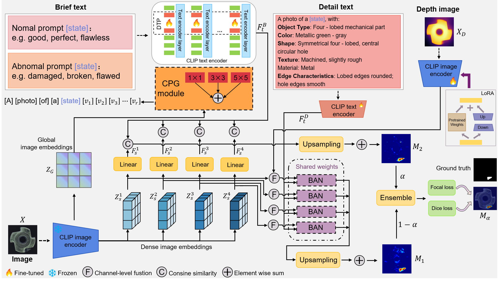

# CPBA-CLIP

**CPBA-CLIP: A Zero-Shot Industrial Anomaly Detection Model with Context-Aware Prompting and Bidirectional Alignment**

CPBA-CLIP combines image-conditioned global prompting with patch-conditioned regional alignment for zero-shot industrial anomaly detection. The Context-Aware Prompt Generator (CPG) adapts global normal/abnormal text prompts to each image. The Bidirectional Alignment Network (BAN) exchanges information between regional text states and image patches before pixel-level anomaly scoring.



## Contents

- [Environment](#environment)
- [Data Preparation](#data-preparation)
- [Pre-trained Weights](#pre-trained-weights)
- [Experiments](#experiments)
- [Citation](#citation)

## Environment

The reported experiments used Python 3.11, PyTorch 2.10.0, torchvision 0.25.0, and CUDA 12.8. Install the matching PyTorch build first, then install the remaining dependencies:

```bash
conda create -n cpba-clip python=3.11 -y
conda activate cpba-clip
pip install torch==2.10.0 torchvision==0.25.0 --index-url https://download.pytorch.org/whl/cu128
pip install -r requirements.txt
```

For a different CUDA version, install the matching PyTorch/torchvision build from the [official PyTorch installer](https://pytorch.org/get-started/locally/) before installing `requirements.txt`.

## Data Preparation

The prepared `dataset/mvisa/` directory is hosted separately and is intentionally not included in this GitHub repository because of its size. The remaining files under `dataset/`, including the dataset conversion and metadata-generation scripts, are included in the repository. Download the prepared `mvisa` package from the following cloud-drive link, then extract it under `dataset/`:

> **Dataset download:** `DATASET_DOWNLOAD_LINK_TO_BE_ADDED`

After extraction, the repository should contain `./dataset/mvisa/`. The package should provide the unified MVTec-AD and VisA data and metadata files used by the training and testing scripts. If you prepare the data from the original MVTec-AD and VisA releases instead, use the scripts already included in `dataset/` and keep the following layout:

```text
dataset/mvisa/data/
├── visa/
│   └── <category>/
│       ├── train/<normal-or-defect>/*
│       ├── test/<normal-or-defect>/*
│       └── ground_truth/<defect>/*
├── mvtec/
│   └── <category>/
│       ├── train/<normal-or-defect>/*
│       ├── test/<normal-or-defect>/*
│       └── ground_truth/<defect>/*
├── meta_visa.json
└── meta_mvtec.json
```

The metadata JSON files must describe image and mask paths relative to `dataset/mvisa/data`. When using the downloadable prepared package, no additional conversion is required. When preparing the data yourself, update the source-dataset paths in the utilities under `dataset/` and run the metadata generation scripts as needed.

For RGB + Depth experiments, place a grayscale depth image next to each RGB image using the same filename stem and the `_depth` suffix, for example `sample.bmp` and `sample_depth.png`. BAN loads these files when `--use_depth True` is enabled. Attribute descriptions are optional text files next to the RGB images with the same stem and a `.txt` extension; enable them with `--use_attribute_text True`.

## Pre-trained Weights

The `pretrained_weight/` directory is not included in this GitHub repository because the checkpoint files are too large. Download the required OpenAI CLIP weights from the following external link, then extract them into the repository root:

> **Pre-trained weights download:** `PRETRAINED_WEIGHTS_DOWNLOAD_LINK_TO_BE_ADDED`

After extraction, the repository should contain the following file for the commands in this README:

```text
pretrained_weight/ViT-L-14-336px.pt
```

The commands below use `models/model_configs/ViT-L-14-336.json`. If you download the weights directly from OpenAI instead, place the matching checkpoint at the same path.

## Experiments

Run commands from the repository root. Training uses all categories in the selected source dataset and validates on the other dataset. Testing evaluates on the target dataset. The commands below cover the two transfer directions used for the component-ablation and modality-comparison experiments.

### CPG/BAN Ablation

The four settings are the full model, without CPG (`--use_global`), without BAN (`--use_regional`), and without both. These flags disable the corresponding module. When BAN is disabled, regional text embeddings are compared directly with RGB patch features.

The following Bash loop trains all four settings in both transfer directions:

```bash
for direction in mvtec_to_visa visa_to_mvtec; do
  if [ "$direction" = "mvtec_to_visa" ]; then
    source_dataset=mvtec
    target_dataset=visa
  else
    source_dataset=visa
    target_dataset=mvtec
  fi

  for setting in full without_cpg without_ban without_cpg_ban; do
    module_flags=()
    case "$setting" in
      without_cpg) module_flags+=(--use_global) ;;
      without_ban) module_flags+=(--use_regional) ;;
      without_cpg_ban) module_flags+=(--use_global --use_regional) ;;
    esac

    python train.py \
      --dataset "$source_dataset" \
      --val_dataset "$target_dataset" \
      --train_data_path ./dataset/mvisa/data \
      --val_data_path ./dataset/mvisa/data \
      --save_path "./exps/ablation/${direction}/${setting}" \
      --pretrained_path ./pretrained_weight/ViT-L-14-336px.pt \
      --config_path ./models/model_configs/ViT-L-14-336.json \
      --model ViT-L-14-336 \
      --use_attribute_text True \
      "${module_flags[@]}"
  done
done
```

Test a trained ablation checkpoint. Set `DIRECTION` and `TARGET` for the desired transfer direction, and set `SETTING` to `full`, `without_cpg`, `without_ban`, or `without_cpg_ban`:

```bash
# MVTec-AD -> VisA
DIRECTION=mvtec_to_visa
TARGET=visa
SETTING=full

# For VisA -> MVTec-AD, use:
# DIRECTION=visa_to_mvtec
# TARGET=mvtec

MODULE_FLAGS=()
case "$SETTING" in
  without_cpg) MODULE_FLAGS+=(--use_global) ;;
  without_ban) MODULE_FLAGS+=(--use_regional) ;;
  without_cpg_ban) MODULE_FLAGS+=(--use_global --use_regional) ;;
esac

python test.py \
  --data_path ./dataset/mvisa/data \
  --dataset "$TARGET" \
  --checkpoint_path "./exps/ablation/${DIRECTION}/${SETTING}/epoch_15.pth" \
  --save_path "./results/ablation/${DIRECTION}/${SETTING}" \
  --pretrained_path ./pretrained_weight/ViT-L-14-336px.pt \
  --config_path ./models/model_configs/ViT-L-14-336.json \
  --model ViT-L-14-336 \
  --use_attribute_text True \
  "${MODULE_FLAGS[@]}"
```

Replace `epoch_15.pth` with the checkpoint selected by validation when a different epoch is used.

### RGB vs. RGB + Depth

This comparison uses the full CPG + BAN model. The following loop trains RGB-only and RGB + Depth configurations in both transfer directions:

```bash
for direction in mvtec_to_visa visa_to_mvtec; do
  if [ "$direction" = "mvtec_to_visa" ]; then
    source_dataset=mvtec
    target_dataset=visa
  else
    source_dataset=visa
    target_dataset=mvtec
  fi

  for modality in rgb rgb_depth; do
    depth_flag=()
    if [ "$modality" = "rgb_depth" ]; then
      depth_flag+=(--use_depth True)
    fi

    python train.py \
      --dataset "$source_dataset" \
      --val_dataset "$target_dataset" \
      --train_data_path ./dataset/mvisa/data \
      --val_data_path ./dataset/mvisa/data \
      --save_path "./exps/modality/${direction}/${modality}" \
      --pretrained_path ./pretrained_weight/ViT-L-14-336px.pt \
      --config_path ./models/model_configs/ViT-L-14-336.json \
      --model ViT-L-14-336 \
      --use_attribute_text True \
      "${depth_flag[@]}"
  done
done
```

Evaluate the selected checkpoint with the matching modality setting:

```bash
# Set these for each run.
DIRECTION=mvtec_to_visa
TARGET=visa
MODALITY=rgb

# For VisA -> MVTec-AD, set DIRECTION=visa_to_mvtec and TARGET=mvtec.
# For RGB + Depth, set MODALITY=rgb_depth.

DEPTH_FLAG=()
if [ "$MODALITY" = "rgb_depth" ]; then
  DEPTH_FLAG+=(--use_depth True)
fi

python test.py \
  --data_path ./dataset/mvisa/data \
  --dataset "$TARGET" \
  --checkpoint_path "./exps/modality/${DIRECTION}/${MODALITY}/epoch_15.pth" \
  --save_path "./results/modality/${DIRECTION}/${MODALITY}" \
  --pretrained_path ./pretrained_weight/ViT-L-14-336px.pt \
  --config_path ./models/model_configs/ViT-L-14-336.json \
  --model ViT-L-14-336 \
  --use_attribute_text True \
  "${DEPTH_FLAG[@]}"
```

When testing RGB + Depth, depth files must be available for all evaluated images. Replace `epoch_15.pth` with the selected validation checkpoint when needed.

## Citation

If you use this code, please cite the CPBA-CLIP paper. Add the final bibliographic entry here once the publication or preprint details are available.
