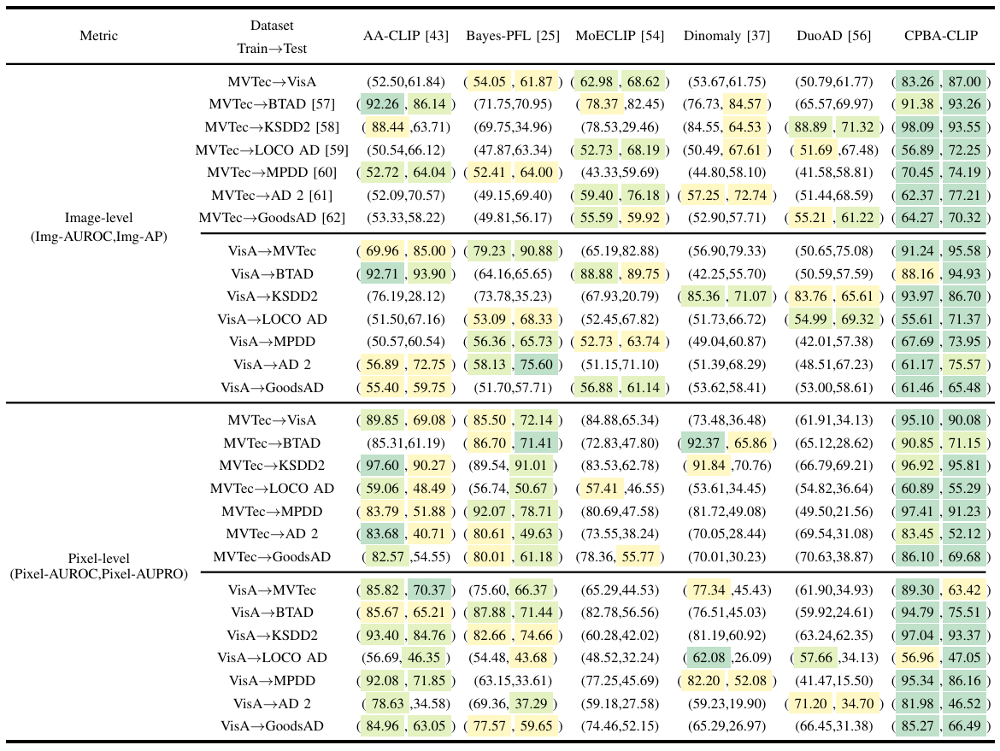

# CPBA-CLIP

**CPBA-CLIP: A Zero-Shot Industrial Anomaly Detection Model with Context-Aware Prompting and Bidirectional Alignment**

CPBA-CLIP combines image-conditioned global prompting with patch-conditioned regional alignment for zero-shot industrial anomaly detection. The Context-Aware Prompt Generator (CPG) adapts global normal/abnormal text prompts to each image. The Bidirectional Alignment Network (BAN) exchanges information between regional text states and image patches before pixel-level anomaly scoring.


## Quick Start

### 1. Installation

```bash
conda create -n cpba-clip python=3.11 -y
conda activate cpba-clip
pip install torch==2.10.0 torchvision==0.25.0 --index-url https://download.pytorch.org/whl/cu128
pip install -r requirements.txt
```

### 2. Dataset and pretrained weights

`dataset/mvisa/` and `pretrained_weight/` are not included in this repository. Download the prepared dataset and CLIP checkpoint, then place them as follows (the default backbone is `ViT-L-14-336px.pt`):

```text
dataset/mvisa/data/                 # MVTec-AD, VisA, metadata, and optional depth files
pretrained_weight/ViT-L-14-336px.pt
```

Other files under `dataset/`, including dataset utilities, are included.

### 3. Training and evaluation

Run commands from the repository root. Default dataset and model paths are configured in `train.py` and `test.py`.

**CPG/BAN ablation:** use no flag for the full model; `--use_global` disables CPG, and `--use_regional` disables BAN.

```bash
# MVTec-AD → VisA
python train.py --dataset mvtec --val_dataset visa --save_path ./exps/mvtec_to_visa/full
python train.py --dataset mvtec --val_dataset visa --save_path ./exps/mvtec_to_visa/no_cpg --use_global
python train.py --dataset mvtec --val_dataset visa --save_path ./exps/mvtec_to_visa/no_ban --use_regional

# VisA → MVTec-AD
python train.py --dataset visa --val_dataset mvtec --save_path ./exps/visa_to_mvtec/full
python train.py --dataset visa --val_dataset mvtec --save_path ./exps/visa_to_mvtec/no_cpg --use_global
python train.py --dataset visa --val_dataset mvtec --save_path ./exps/visa_to_mvtec/no_ban --use_regional
```

Evaluate a checkpoint with the same dataset and ablation flag used for training:

```bash
python test.py --dataset visa --checkpoint_path ./exps/mvtec_to_visa/no_ban/epoch_1.pth \
  --save_path ./results/mvtec_to_visa/no_ban --use_regional
python test.py --dataset mvtec --checkpoint_path ./exps/visa_to_mvtec/no_ban/epoch_1.pth \
  --save_path ./results/visa_to_mvtec/no_ban --use_regional
```

Replace `epoch_1.pth` with the checkpoint selected for evaluation. To disable both modules, pass `--use_global --use_regional` to both training and testing.

**RGB vs. RGB + Depth** (example: MVTec-AD → VisA): omit `--use_depth True` for RGB-only runs.

```bash
python train.py --dataset mvtec --val_dataset visa --save_path ./exps/mvtec_to_visa/rgb
python test.py --dataset visa --checkpoint_path ./exps/mvtec_to_visa/rgb/epoch_1.pth \
  --save_path ./results/mvtec_to_visa/rgb

python train.py --dataset mvtec --val_dataset visa --save_path ./exps/mvtec_to_visa/rgb_depth --use_depth True
python test.py --dataset visa --checkpoint_path ./exps/mvtec_to_visa/rgb_depth/epoch_1.pth \
  --save_path ./results/mvtec_to_visa/rgb_depth --use_depth True
```

## Comparison with State-of-the-art methods



Using MVTec-AD and VisA as separate training sources, we added six industrial test datasets and compared CPBA-CLIP with SOTA models using RGB-only. all values are percentages. MVTec, LOCO AD, and AD 2 denote MVTec-AD, MVTec LOCO AD, and MVTec AD 2, respectively.

## Citation

```bibtex
@misc{cpba_clip,
  title = {CPBA-CLIP: A Zero-Shot Industrial Anomaly Detection Model with Context-Aware Prompting and Bidirectional Alignment}
}
```

